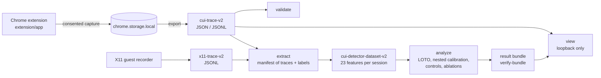

# ComputerUseAgent

**English** | [简体中文](README.zh-CN.md)

[](https://github.com/appleweiping/ComputerUseAgent/actions/workflows/ci.yml)
[](https://github.com/appleweiping/ComputerUseAgent/actions/workflows/codeql.yml)
[](LICENSE)
[](pyproject.toml)

ComputerUseAgent **records and analyses interaction traces** of computer-use
agents and of people doing the same task, so that the two can be compared. It
is a measurement toolkit, **not an agent**: nothing in it operates a computer
on anyone's behalf. It ships a consent-first Chrome recorder, a Python library
and CLI that validate traces, extract behavioral features and run a
leakage-controlled human-versus-agent analysis, a loopback-only viewer, and the
archived research that produced them.

> [!IMPORTANT]
> **No validated human-versus-agent detector exists yet.** The package's
> detector pipeline has run only on synthetic data, and every result it writes carries
> `formal_claim_permitted=false`. The formal studies produced no data: MiniWoB
> 0/27<!-- claim:formal.miniwob.completed_attempts --> attempts and ScienceBoard
> 0/27<!-- claim:formal.scienceboard.collected_sessions --> sessions completed,
> Codex Desktop 9/9<!-- claim:formal.codex.blocked_attempts --> attempts blocked.
> Human traces collected by this project:
> 0<!-- claim:formal.human_traces -->. See [Research results](#research-results).

## What is in the box

| Component | Where | What it does |
|---|---|---|
| **Trace recorder** (Chrome Manifest V3 extension, "ComputerUseAgent Trace Recorder") | [`extension/app`](extension/app) | After explicit consent, records privacy-reduced traces from one tab: 59 DOM event types plus a recorder-generated navigation record. Traces stay in local extension storage until you delete them; you can inspect them and export copies (JSON, JSONL, CSV, legacy V1) from the dashboard. Exporting does not remove them. It makes no network requests. |
| **Python library and CLI** `computer-use-agent` | [`src/computer_use_agent`](src/computer_use_agent) | Schema and contract validation; extraction of 23 behavioral features from browser or X11 traces; a deterministic detector pipeline with strict leave-one-task-out (LOTO) evaluation, nested Platt calibration and negative controls; a self-verifying six-file result bundle. Standard library plus `jsonschema`. |
| **Viewer** | `computer-use-agent view` | Loopback-only, read-only, privacy-projected viewer for traces and analysis results. |
| **X11 capture** | [`src/computer_use_agent/capture/x11`](src/computer_use_agent/capture/x11) | Guest-side recorder for desktop sessions, deployed as one deterministic zipapp. Built for the archived ScienceBoard study, which never ran on a VM. |
| **Research archive** | [`research/`](research/README.md) | Agent harnesses, pilots, FP-Agent analyses, the literature corpus and hash-verified evidence. Provenance, not product; not part of the wheel. |



Wire formats keep their historical `cui-` namespace (`cui-trace-v2`,
`cui-detector-dataset-v2`, the `chrome.storage` keys), so traces recorded by
earlier versions stay readable. See [docs/architecture.md](docs/architecture.md).

## Prerequisites

- **Python 3.12 or newer** (CI tests 3.12 and 3.13).
  [uv](https://docs.astral.sh/uv/) is recommended; plain `pip` works too.
- **Chrome or Chromium 151 or newer** to load the extension. That is the
  manifest's `minimum_chrome_version`, and the E2E suite runs Chrome for Testing
  151.0.7922.47; older versions were never tested.
- **Node.js 22.12 or newer** with npm, only for extension development, unit
  tests and the E2E suite. ESLint 10 needs Node 22.13 or newer.

## Quick start

### 1. Install

```sh
git clone https://github.com/appleweiping/ComputerUseAgent.git
cd ComputerUseAgent
uv sync                     # .venv with the package (editable) and the dev tools from uv.lock
```

Without uv, create and activate a virtual environment, then run
`python -m pip install -e .`.

### 2. Load the recorder

Open `chrome://extensions`, turn on **Developer mode**, choose **Load
unpacked** and select `extension/app`. In the popup, choose the actor type and
the task ID, read the linked disclosure and tick the consent box; recording
cannot start without it. Inspect, export or delete sessions in **Sessions &
exports**. Details: [docs/extension/index.md](docs/extension/index.md).

### 3. Use the CLI

Run these from the repository root. With uv, prefix each command with `uv run`
or activate `.venv` first.

<!-- readme-check: run -->
```sh
computer-use-agent doctor
computer-use-agent schema list
computer-use-agent validate --schema cui-trace-v2 --input examples/traces/minimal-session-v2.json
computer-use-agent analyze --dataset examples/detector/synthetic-dataset.json --output-dir out/run1 --profile smoke
computer-use-agent verify-bundle out/run1
computer-use-agent view --trace demo=examples/traces/minimal-session-v2.json --port 0
```

- `doctor` checks Python, `jsonschema` and the packaged data (required) and
  Node and Chrome (optional); it exits non-zero only if a required check fails.
- `analyze --profile smoke` is a fast code-path check that takes seconds; the
  `default` profile (the documented protocol) takes about two minutes on this
  18-record synthetic dataset. Both are labelled "Synthetic pipeline check
  only". `analyze` refuses an existing output directory, so delete `out/`
  before running it again.
- `view` prints its `http://127.0.0.1:<port>/` URL; stop it with Ctrl+C.
- To analyze your own traces, write an extraction manifest and run
  `computer-use-agent extract --manifest my-manifest.json --output dataset.json`;
  see [docs/detector.md](docs/detector.md). Datasets that carry provenance need
  a registered validator (`--provenance-module NAME`) or they are rejected.

### 4. Try the playground

The playground runs the recorder's normalization core in a plain page, without
the extension. Serve it on loopback only:

```sh
python -m http.server 8765 --bind 127.0.0.1 --directory extension
```

Then open <http://127.0.0.1:8765/playground/>. Its downloads are synthetic QA
traces (`source_class=synthetic_coverage`), not study data.

## Privacy model

The recorder collects behavioral data about people, so it stores as little as
it can and says plainly what remains. Full field list:
[docs/extension/privacy.md](docs/extension/privacy.md).

**Stored per event:** the event type, wall-clock and page-relative timestamps,
session ordering fields, the page URL without query or fragment, the viewport
size, pointer coordinates and buttons (moves are sampled), wheel and scroll
offsets, modifier flags, focus and form lifecycle events, minimal target
metadata (tag, role, input type and a short selector hint), document visibility
and `is_trusted` as a diagnostic. The session keeps the labels typed into the
popup.

**Never stored:** typed characters, except in the opt-in raw-key mode below (by
default key events keep a key class such as `letter` or `digit`, and the key
only for control keys such as `Enter`),
`KeyboardEvent.code`, input values (only the input type and the number of
inserted characters), clipboard and drag contents (only MIME categories and
counts), URL queries and fragments, page text, form values, file names,
cookies, screenshots, audio and video.

**Private fields.** On password inputs, `autocomplete` `current-password` or
`new-password` fields and anything inside `[data-recorder-private]`, version
0.5.0 also drops the key class, the modifier flags and the keystroke detail
(hold time, repeat, location); the key is the constant `<redacted>`. The
service worker re-applies these rules to every stored event.

- **Fixed in 0.5.0:** version 0.4.0 kept the key class, modifier flags and
  keystroke timing on private fields although its documentation called them
  "always redacted". Treat 0.4.0 traces of such fields as sensitive; see the
  Security section of [CHANGELOG.md](CHANGELOG.md).
- **Still recorded:** the existence, type and timestamps of key, input and
  focus events on private fields. Their count and timing reveal the
  approximate length and rhythm of what was typed, so never type real
  credentials while recording; use test accounts.

**Scope and storage.** Permissions are `activeTab`, `scripting`, `storage` and
`unlimitedStorage`, plus an optional per-origin host permission requested only
when the user asks for it; there is no `downloads` permission. Storage is
restricted to trusted extension contexts and bounded (250 sessions, 100,000
events and about 64 MiB per session, 512 MiB in total). A restricted raw-key
mode stores the typed key value on non-private fields; it needs a second
confirmation, and its traces fail the public schema and must never be
published.

**Known capture gaps.** After a same-origin navigation nothing is captured
until the content script is injected again at `status=complete`; navigating the
tab to another origin ends the session as interrupted.

## Data and ethics boundaries

- **No raw human traces are in this repository**, and none may be added, nor
  attached to issues or pull requests. Tests and examples use synthetic data.
- **Recording anyone other than yourself** requires that person's informed
  consent and whatever approval your own human-research process requires,
  obtained before recording. The extension's disclosure page is a neutral
  operator template: replace its bracketed fields with your approved wording.
- **Formal human data are denied by default.** `analyze` admits them only when
  the dataset's `provenance.source_stage` has a registered validator (loaded
  with `--provenance-module`) that accepts the dataset **and** a
  `human_data_policy` hook that authorizes them; the hook re-authorizes them in
  every evaluation fold. Accepting provenance alone never authorizes formal
  human data: a stage without the hook gets them denied. The archived
  ScienceBoard stage (`research.scienceboard.detector_bridge`) accepts them
  only through a formal-study configuration whose human-research determination
  record (named by `CUA_HUMAN_RESEARCH_DETERMINATION_RECORD`) matches its
  recorded SHA-256. A stage you write must enforce this itself, for example by
  returning `ConfigHumanDataPolicy` (`computer_use_agent.study.policy`) from its
  `human_data_policy` hook. See [docs/detector.md](docs/detector.md).
- **Private data live under `CUA_PRIVATE_ROOT`**, which must resolve outside
  the repository and outside `research/evidence`; tools refuse to write private
  data anywhere else.

| Variable | Purpose |
|---|---|
| `CUA_PRIVATE_ROOT` | Root for private, non-redistributable data |
| `CUA_FORMAL_STUDY_CONFIG` | Formal-study configuration, when not passed explicitly |
| `CUA_HUMAN_RESEARCH_DETERMINATION_RECORD` | The operator's private human-research determination record, kept under `CUA_PRIVATE_ROOT` |
| `CUA_E2E_*` | Extension E2E harness settings, see [docs/extension/e2e.md](docs/extension/e2e.md) |

Nothing loads [.env.example](.env.example) automatically; it documents these
variables.

## Development

```sh
uv sync                                       # dev tools at the versions in uv.lock
uv run nox                                    # lint, typecheck, tests (3.12 and 3.13), node
uv run nox -l                                 # list every session
uv run nox -s research build evidence docs    # research tests, packaging, evidence, docs
uv run pre-commit install                     # optional: run the hooks on every commit
npm --prefix extension ci
npm --prefix extension run lint
npm --prefix extension test
npm --prefix extension run test:coverage
npm --prefix extension run e2e                # opens a browser window
```

- **E2E.** The recorder suite drives the real extension in a disposable Chrome
  profile through 15 cases (T00 to T14) and writes a result bundle that
  `python tools/ci/validate_e2e_bundle.py <bundle directory>` checks. On Linux
  without a display, run it under `xvfb-run -a`. CI also sets
  `CUA_E2E_CI_NO_SANDBOX=1` because the runner's kernel blocks Chrome's sandbox;
  never set it on a workstation. `CUA_E2E_HEADLESS=1` uses Chrome's new
  headless mode instead of a window. See [docs/extension/e2e.md](docs/extension/e2e.md).
- **Research code** needs the research extra: `uv sync --extra research`, then
  `uv run nox -s research` or `uv run pytest research`.
  `python -B -m research.reproduce --dry-run` lists the reproducible stages, and
  `python -m research.literature.fetch_large` downloads the two large literature
  files. See [research/README.md](research/README.md).
- Contribution rules: [CONTRIBUTING.md](CONTRIBUTING.md).

## Testing and CI

The lint, type-check, test, build, evidence and docs checks can be run locally
through nox, on Windows or Linux; the extension ZIP's byte-for-byte
reproducibility is covered locally by `tests/tools/test_package_extension.py`.
actionlint, the build job's wheel and sdist content assertions, CodeQL and the
dependency audits (`pip-audit`, `npm audit`) run only in GitHub Actions. In
GitHub Actions the test jobs run on both Ubuntu and Windows. Test counts are
reported by CI, not listed here.

| Workflow | What it runs |
|---|---|
| `ci.yml` | ruff, actionlint, ESLint, secret scan and pinned-Action check; strict mypy; product tests with a branch-coverage gate; research tests on public data; extension unit tests with a coverage gate; the evidence manifest; this README's links, commands and numbers (`tools/ci/check_readme.py`); wheel, sdist and extension ZIP builds |
| `e2e.yml` | The headful recorder E2E suite under Xvfb, validated by `tools/ci/validate_e2e_bundle.py` |
| `codeql.yml` | CodeQL for Python, JavaScript and the workflows |
| `audit.yml` | `pip-audit` over `uv.lock` and `npm audit` |
| `release.yml` | Tag-driven release: wheel, sdist, extension ZIP, CycloneDX SBOM, checksums and build-provenance attestations |

Details: [docs/ci.md](docs/ci.md) and [docs/releasing.md](docs/releasing.md).

## Repository layout

```text
.
├── extension/              Chrome MV3 recorder
│   ├── app/                the unpacked extension: manifest.json, src/, popup/, dashboard/, privacy/, icons/
│   ├── playground/         standalone page that runs the recorder core
│   ├── test/               unit tests (node --test) and the Puppeteer E2E harness
│   └── scripts/            version check and icon generator
├── src/computer_use_agent/ installable Python package
│   ├── cli.py              console script
│   ├── schemas/            packaged JSON Schemas
│   ├── contracts/          contract and schema validation
│   ├── trace/              shared trace reader, validation and privacy rules
│   ├── features/           behavioral feature extraction and statistics
│   ├── detector/           dataset contract, model, LOTO evaluation, reporting, result bundle
│   ├── viewer/             loopback-only viewer and its static assets
│   ├── capture/x11/        X11 guest recorder and its zipapp builder
│   └── study/              fail-closed formal-study policy and run ledger
├── tests/                  product tests (pytest)
├── examples/               synthetic example traces and detector dataset
├── docs/                   documentation; start at docs/index.md
├── tools/                  CI checks and the extension packager
├── research/               archived harnesses, analyses, literature and evidence
├── noxfile.py              task runner sessions
├── pyproject.toml, uv.lock project metadata and the locked dependency graph
└── .github/                workflows, issue templates, Dependabot
```

## Research results

This repository grew out of a research project on whether privacy-reduced
interaction timing and movement can tell people from computer-use agents. The
table summarizes the archived evidence. Every number is bound to a claim in
[research/evidence/INDEX.json](research/evidence/INDEX.json), which
`tools/ci/verify_evidence.py` checks against the archived files and
`tools/ci/check_readme.py` checks against this table. They are historical
measurements, not results of the current version. The method and the full
narrative are in [docs/research/summary.md](docs/research/summary.md).

<!-- results:begin -->

| Study | Result | Caveat |
|---|---|---|
| Recorder E2E, archived run of recorder 0.4.0<!-- claim:recorder_e2e.extension_version --> (2026-08-09<!-- claim:recorder_e2e.run_started_at -->) | 14/14<!-- claim:recorder_e2e.cases_passed --> cases, 0<!-- claim:recorder_e2e.browser_errors --> browser errors. 527<!-- claim:recorder_e2e.records_total --> records: 516<!-- claim:recorder_e2e.records_natural --> natural, 10<!-- claim:recorder_e2e.records_synthetic --> synthetic, 1<!-- claim:recorder_e2e.records_navigation --> navigation. 42 of 59<!-- claim:recorder_e2e.types_observed --> supported event types observed, 17<!-- claim:recorder_e2e.types_never_observed --> never observed | One automated QA run on deterministic loopback fixtures with Chrome 151.0.7922.108<!-- claim:recorder_e2e.chrome_version -->, Puppeteer 25.4.0<!-- claim:recorder_e2e.puppeteer_version -->, Node 22.21.1<!-- claim:recorder_e2e.node_version --> on win32-x64<!-- claim:recorder_e2e.platform -->; not human, agent or detector data. The cited commit 621ad8ac<!-- claim:recorder_e2e.cited_commit --> exists only in the private source repository; the source-tree SHA-256 prefix fa5cfc61<!-- claim:recorder_e2e.source_tree_sha256 --> identifies the tested code. CI reruns the current suite on every extension change. |
| FP-Agent released models, inference only | Accuracy / macro-F1 on 1,544<!-- claim:fp_agent.released.test_examples --> test examples, 8<!-- claim:fp_agent.released.classes --> classes: browser 0.8212<!-- claim:fp_agent.released.browser_accuracy --> / 0.8223<!-- claim:fp_agent.released.browser_macro_f1 -->, behavioral 0.9994<!-- claim:fp_agent.released.behavioral_accuracy --> / 0.9994<!-- claim:fp_agent.released.behavioral_macro_f1 -->, combined 1.0000<!-- claim:fp_agent.released.combined_accuracy --> / 1.0000<!-- claim:fp_agent.released.combined_macro_f1 --> | The authors' random within-corpus split: it does not measure unseen agents or deployment. Upstream commit e614e2f<!-- claim:fp_agent.released.upstream_commit -->, run under Python 3.13.14<!-- claim:fp_agent.released.python --> outside the hash-locked research environment. |
| Leave-one-agent-family-out on the FP-Agent feature vectors | 21<!-- claim:fp_agent.loafo.folds --> folds. Browser features: mean balanced accuracy (BA) 0.9286<!-- claim:fp_agent.loafo.browser_mean_ba -->, worst fold 0.5000<!-- claim:fp_agent.loafo.browser_worst_ba -->; with Manus<!-- claim:fp_agent.loafo.browser_manus_fold_family --> held out, recall 0.0<!-- claim:fp_agent.loafo.browser_manus_recall --> at AUROC 0.9174<!-- claim:fp_agent.loafo.browser_manus_auroc -->. Behavioral and combined features: BA ≥0.9968<!-- claim:fp_agent.loafo.behavioral_min_ba --><!-- claim:fp_agent.loafo.combined_min_ba --> in every fold | The ranking transfers but the threshold does not. The same 109<!-- claim:fp_agent.loafo.human_test_rows --> human test rows are reused in every fold, so the folds are not independent. Run under Python 3.14.5<!-- claim:fp_agent.loafo.python --> outside the hash-locked environment. |
| 23-feature retrospective on the public FP-Agent raw corpus | 7,728<!-- claim:fp_agent.retro.sessions --> sessions (546<!-- claim:fp_agent.retro.human_sessions --> human, 7,182<!-- claim:fp_agent.retro.agent_sessions --> agent), 3<!-- claim:fp_agent.retro.tasks --> tasks, seed 20260811<!-- claim:fp_agent.retro.seed -->. Primary purged leave-one-task-out logistic model: pooled BA 0.6001<!-- claim:fp_agent.retro.pooled_ba -->, AUROC 0.6358<!-- claim:fp_agent.retro.pooled_auroc -->, macro-F1 0.5746<!-- claim:fp_agent.retro.pooled_macro_f1 -->. Held-out task BA / AUROC: Flight-booking 0.500<!-- claim:fp_agent.retro.flight_ba --> / 0.998<!-- claim:fp_agent.retro.flight_auroc -->, Forums 0.497<!-- claim:fp_agent.retro.forums_ba --> / 0.829<!-- claim:fp_agent.retro.forums_auroc -->, Shopping 0.853<!-- claim:fp_agent.retro.shopping_ba --> / 0.967<!-- claim:fp_agent.retro.shopping_auroc --> | Read it as a cross-task threshold and calibration transfer failure, not as chance-level ranking. Only n=3 tasks: the reported BA interval 0.497<!-- claim:fp_agent.retro.ba_interval_lower --> to 0.853<!-- claim:fp_agent.retro.ba_interval_upper --> is the min/max over the 3 folds, not a population confidence interval. The pooled AUROC mixes three separately calibrated fold models; AUPRC 0.958<!-- claim:fp_agent.retro.pooled_auprc --> is inflated by the 92.9% agent prevalence; the purge leaves 79<!-- claim:fp_agent.retro.purge_train_rows_flight -->/212<!-- claim:fp_agent.retro.purge_train_rows_forums -->/37<!-- claim:fp_agent.retro.purge_train_rows_shopping --> training rows; focus is never observed (`missing_focus=1`<!-- claim:fp_agent.retro.missing_focus --> everywhere); the permutation p-value 0.000999<!-- claim:fp_agent.retro.permutation_p --> is the minimum possible with 1,000<!-- claim:fp_agent.retro.permutation_draws --> draws. The same features predict the task (BA 0.866<!-- claim:fp_agent.retro.task_confound_ba -->) and the agent family (BA 0.974<!-- claim:fp_agent.retro.source_confound_ba -->), a strong confound, and dropping the keyboard features raises BA by +0.181<!-- claim:fp_agent.retro.keyboard_ablation_delta -->. |
| Agent pilots on three public read-only micro-tasks (example.com, IANA, Hacker News) | Browser-Use 0.11.5<!-- claim:pilots.browser_use.version -->: 9/9<!-- claim:pilots.browser_use.successful_runs -->, US$0.436519<!-- claim:pilots.browser_use.cost_usd -->. Skyvern 1.0.47<!-- claim:pilots.skyvern.version -->: 9/9<!-- claim:pilots.skyvern.successful_runs -->, US$0.432419<!-- claim:pilots.skyvern.cost_usd -->. Stagehand 3.7.1<!-- claim:pilots.stagehand.version -->: 3/3<!-- claim:pilots.stagehand.successful_runs -->, cost not reported | Integration evidence, not benchmark scores; costs are application-reported and not reconciled to provider invoices. Stagehand was a single-pass smoke run and was later retired over 13<!-- claim:pilots.stagehand.blocking_advisories --> blocking security advisories. |
| Formal studies | MiniWoB 0/27<!-- claim:formal.miniwob.completed_attempts -->; ScienceBoard 0/27<!-- claim:formal.scienceboard.collected_sessions -->; Codex Desktop 9/9<!-- claim:formal.codex.blocked_attempts --> blocked; human traces collected: 0<!-- claim:formal.human_traces --> | The 2<!-- claim:formal.miniwob.published_failure_records --> Browser-Use launches of the MiniWoB matrix ended with `model_provider_error`<!-- claim:formal.miniwob.attempt1_cause --> and 0<!-- claim:formal.miniwob.attempt1_actions --><!-- claim:formal.miniwob.attempt2_actions --> actions; a later preflight got HTTP 502<!-- claim:formal.miniwob.preflight_http_status --> (no evidence file records an HTTP 403). The ScienceBoard harness never ran on a VM. The NetLogo/PhET runs (9/9<!-- claim:formal.simulators.passed_runs --> passed, 908<!-- claim:formal.simulators.events --> events, recorder 0.2.1) are scripted Puppeteer/CDP controls, not agents. |
| Auxiliary public datasets | MolmoWeb action n-gram source classifier BA 0.8167<!-- claim:aux.molmoweb.action_sequence_ba -->; domain-only baseline BA 0.5<!-- claim:aux.molmoweb.domain_only_ba --> | Likely label leakage: only synthetic rows carry `action_timestamp` (108,254<!-- claim:aux.molmoweb.synthetic_rows_with_action_timestamp --> synthetic rows, 0<!-- claim:aux.molmoweb.human_rows_with_timestamp --> human rows). The domain-only baseline is 0.5 by construction. CaptchaSolve30k and Aalto are sampling-fidelity checks only. |
| Literature corpus | 68<!-- claim:literature.items --> items: 64<!-- claim:literature.papers --> papers and 4<!-- claim:literature.repositories --> repositories; 60<!-- claim:literature.fulltext_reviewed --> full texts reviewed, 4<!-- claim:literature.access_blocked --> access-blocked, 4<!-- claim:literature.repository_reviews --> repository reviews. Citation graph: 12,932<!-- claim:literature.citation_nodes --> nodes, 22,117<!-- claim:literature.citation_assertions --> assertions | Counts come from the persisted snapshot; a public clone can check their consistency but cannot re-fetch the private full texts. Citation retrieval is partial (1<!-- claim:literature.citation_partial_directions --> partial and 15<!-- claim:literature.citation_blocked_directions --> blocked seed directions). The two large graph files are not committed; `python -m research.literature.fetch_large` downloads them and verifies their SHA-256. |

<!-- results:end -->

The current recorder E2E suite has 15 cases (T00 to T14); its bundles are CI
artifacts and are not committed.

## Citing

Cite the software with [CITATION.cff](CITATION.cff) (GitHub's "Cite this
repository" button reads it). If you use the archived evidence, also cite the
exact release and the third-party datasets and papers your analysis relies on.

## License

MIT, see [LICENSE](LICENSE) and [NOTICE](NOTICE). Third-party notices are in
[THIRD_PARTY_NOTICES.md](THIRD_PARTY_NOTICES.md). Contributions follow
[CONTRIBUTING.md](CONTRIBUTING.md) and the [Code of Conduct](CODE_OF_CONDUCT.md);
report vulnerabilities privately as described in [SECURITY.md](SECURITY.md).

## Provenance

ComputerUseAgent starts a fresh Git history. Its content was restructured from
the research repository
[appleweiping/cu-detector-research-artifact](https://github.com/appleweiping/cu-detector-research-artifact/tree/437070f519d4bd40e9e4e46bf19fcca52b4b7557)
at commit `437070f`, which remains the archive of record (including the four
PDF deliverables). [research/PROVENANCE.md](research/PROVENANCE.md) maps every
original path to its new location or records why it was not imported.
