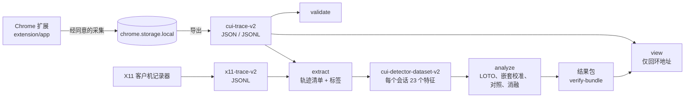

# ComputerUseAgent

[English](README.md) | **简体中文**

[](https://github.com/appleweiping/ComputerUseAgent/actions/workflows/ci.yml)
[](https://github.com/appleweiping/ComputerUseAgent/actions/workflows/codeql.yml)
[](LICENSE)
[](pyproject.toml)

ComputerUseAgent **记录并分析交互轨迹**：既包括计算机使用智能体（computer-use
agent）的轨迹，也包括人在完成同一任务时的轨迹，以便二者对比。它是一套测量工具，
**本身不是智能体**：其中没有任何组件会替任何人操作计算机。项目包含一个以知情同意
为前提的 Chrome 记录器；一个 Python 库及命令行工具，用于校验轨迹、提取行为特征，
并运行控制了信息泄漏的“人类 vs 智能体”分析；一个仅监听回环地址的查看器；以及产
生这些工具的研究存档。

> [!IMPORTANT]
> **目前尚不存在经过验证的“人类 vs 智能体”检测器。** 本包中的检测器流水线只在合成
> 数据上运行过，它写出的每个结果都带有 `formal_claim_permitted=false`。正式研究没有产生任
> 何数据：MiniWoB 完成 0/27<!-- claim:formal.miniwob.completed_attempts --> 次尝试，
> ScienceBoard 完成 0/27<!-- claim:formal.scienceboard.collected_sessions --> 个会话，
> Codex Desktop 有 9/9<!-- claim:formal.codex.blocked_attempts --> 次尝试被阻断。
> 本项目采集的人类轨迹数量：0<!-- claim:formal.human_traces -->。参见[研究结果](#研究结果)。

## 包含哪些组件

| 组件 | 位置 | 作用 |
|---|---|---|
| **轨迹记录器**（Chrome Manifest V3 扩展，“ComputerUseAgent Trace Recorder”） | [`extension/app`](extension/app) | 在明确同意后，从单个标签页记录经过隐私删减的轨迹：59 种 DOM 事件类型，外加记录器生成的导航记录。轨迹保存在本地扩展存储中，直到你删除它们；你可以在仪表盘中查看轨迹并导出副本（JSON、JSONL、CSV、旧版 V1），导出不会删除它们。扩展不发出任何网络请求。 |
| **Python 库与命令行工具** `computer-use-agent` | [`src/computer_use_agent`](src/computer_use_agent) | Schema 与契约校验；从浏览器或 X11 轨迹中提取 23 个行为特征；确定性的检测器流水线，采用严格的留一任务（leave-one-task-out, LOTO）评估、嵌套 Platt 校准和阴性对照；可自我校验的六文件结果包。只依赖标准库和 `jsonschema`。 |
| **查看器** | `computer-use-agent view` | 仅监听回环地址、只读、经过隐私投影的轨迹与分析结果查看器。 |
| **X11 采集** | [`src/computer_use_agent/capture/x11`](src/computer_use_agent/capture/x11) | 桌面会话的客户机端记录器，以单个确定性 zipapp 部署。它为已存档的 ScienceBoard 研究而建，该研究从未在虚拟机上运行过。 |
| **研究存档** | [`research/`](research/README.md) | 智能体测试框架、试点实验、FP-Agent 分析、文献语料库以及经哈希校验的证据。属于来源记录而非产品，不包含在 wheel 中。 |



线上数据格式保留历史上的 `cui-` 命名空间（`cui-trace-v2`、
`cui-detector-dataset-v2`、`chrome.storage` 的键），因此早期版本记录的轨迹依然可读。
参见 [docs/architecture.md](docs/architecture.md)。

## 前置条件

- **Python 3.12 或更高版本**（CI 测试 3.12 和 3.13）。推荐使用
  [uv](https://docs.astral.sh/uv/)，直接用 `pip` 也可以。
- **Chrome 或 Chromium 151 或更高版本**，用于加载扩展。这是清单中的
  `minimum_chrome_version`，E2E 测试套件运行在 Chrome for Testing
  151.0.7922.47 上；更早的版本从未测试过。
- **Node.js 22.12 或更高版本**（含 npm），仅在扩展开发、单元测试和 E2E 测试中需要。
  ESLint 10 需要 Node 22.13 或更高版本。

## 快速开始

### 1. 安装

```sh
git clone https://github.com/appleweiping/ComputerUseAgent.git
cd ComputerUseAgent
uv sync                     # 创建 .venv，包含（可编辑安装的）本包以及 uv.lock 中锁定的开发工具
```

如果不用 uv，请先创建并激活一个虚拟环境，再运行 `python -m pip install -e .`。

### 2. 加载记录器

打开 `chrome://extensions`，开启**开发者模式**，选择**加载已解压的扩展程序**，然后
选中 `extension/app`。在弹出窗口中选择执行者类型和任务 ID，阅读链接的披露说明并勾选
同意框；不勾选就无法开始记录。在 **Sessions & exports** 页面中查看、导出或删除会话。
详见 [docs/extension/index.md](docs/extension/index.md)。

### 3. 使用命令行工具

在仓库根目录下运行以下命令。使用 uv 时，请在每条命令前加 `uv run`，或先激活 `.venv`。

<!-- readme-check: run -->
```sh
computer-use-agent doctor
computer-use-agent schema list
computer-use-agent validate --schema cui-trace-v2 --input examples/traces/minimal-session-v2.json
computer-use-agent analyze --dataset examples/detector/synthetic-dataset.json --output-dir out/run1 --profile smoke
computer-use-agent verify-bundle out/run1
computer-use-agent view --trace demo=examples/traces/minimal-session-v2.json --port 0
```

- `doctor` 检查 Python、`jsonschema` 和包内数据（必需项）以及 Node 和 Chrome（可选
  项）；只有必需项检查失败时才以非零状态退出。
- `analyze --profile smoke` 是只需几秒钟的快速代码路径检查；`default` 配置（即文档
  规定的协议）在这份 18 条记录的合成数据集上大约需要两分钟。两者的结果都标注为
  “Synthetic pipeline check only”。`analyze` 拒绝写入已存在的输出目录，因此再次运行
  前请删除 `out/`。
- `view` 会打印 `http://127.0.0.1:<port>/` 地址；按 Ctrl+C 停止。
- 要分析你自己的轨迹，请编写一个提取清单并运行
  `computer-use-agent extract --manifest my-manifest.json --output dataset.json`；
  参见 [docs/detector.md](docs/detector.md)。携带来源信息（provenance）的数据集需要
  已注册的校验器（`--provenance-module NAME`），否则会被拒绝。

### 4. 试用演示页面

演示页面（playground）在一个普通网页中运行记录器的规范化核心，不需要安装扩展。
请只在回环地址上提供服务：

```sh
python -m http.server 8765 --bind 127.0.0.1 --directory extension
```

然后打开 <http://127.0.0.1:8765/playground/>。它下载的是合成的质量检查轨迹
（`source_class=synthetic_coverage`），不是研究数据。

## 隐私模型

记录器采集的是关于人的行为数据，因此它尽可能少地保存数据，并如实说明还保留了
什么。完整字段列表见 [docs/extension/privacy.md](docs/extension/privacy.md)。

**每个事件保存的内容：** 事件类型、挂钟时间戳与页面相对时间戳、会话排序字段、去掉
查询串和片段的页面 URL、视口尺寸、指针坐标和按键（移动事件经过采样）、滚轮与滚动
偏移、修饰键标志、焦点与表单生命周期事件、最少的目标元数据（标签名、角色、input
类型和一个简短的选择器提示）、文档可见性，以及仅作诊断用的 `is_trusted`。会话会
保存在弹出窗口中输入的标签。

**从不保存的内容：** 键入的字符（下文的可选原始按键模式除外；默认情况下按键事件只
保留 `letter`、`digit` 之类的按键类别，只有 `Enter` 等控制键才保留按键本身）、
`KeyboardEvent.code`、输入值（只保留输入类型和插入字符的数量）、剪贴板和拖放内容
（只保留 MIME 类别和数量）、URL 查询串和片段、页面文本、表单值、文件名、Cookie、
截图、音频和视频。

**私密字段。** 对于密码输入框、`autocomplete` 为 `current-password` 或
`new-password` 的字段，以及位于 `[data-recorder-private]` 内的任何元素，0.5.0 版本
还会丢弃按键类别、修饰键标志和击键细节（按住时长、重复、按键位置）；按键本身是常量
`<redacted>`。Service worker 会对每个存储的事件重新应用这些规则。

- **已在 0.5.0 修复：** 0.4.0 版本在私密字段上保留了按键类别、修饰键标志和击键时序，
  而其文档却称这些字段“总是被脱敏”。请将此类字段的 0.4.0 轨迹视为敏感数据；参见
  [CHANGELOG.md](CHANGELOG.md) 的 Security 部分。
- **仍会记录：** 私密字段上按键、输入和焦点事件的存在、类型和时间戳。它们的数量和时序
  会暴露所输入内容的大致长度和节奏，因此记录时切勿输入真实凭据，请使用测试账号。

**范围与存储。** 权限为 `activeTab`、`scripting`、`storage` 和 `unlimitedStorage`，
外加一个只在用户主动要求时才申请的、按来源（origin）授予的可选主机权限；没有
`downloads` 权限。存储仅限受信任的扩展上下文访问，且有上限（250 个会话；每个会话
100,000 个事件、约 64 MiB；总计 512 MiB）。另有一个受限原始按键模式，会在非私密
字段上保存键入的按键值；它需要二次确认，其轨迹无法通过公开 Schema 校验，且绝不能发布。

**已知的采集空白。** 同源导航之后，直到内容脚本在 `status=complete` 时被重新注入
之前，不会采集任何内容；把标签页导航到另一个来源会使会话以“中断”状态结束。

## 数据与伦理边界

- **本仓库中没有任何原始人类轨迹**，也不允许添加，或附在 issue 和 pull request 中。
  测试和示例只使用合成数据。
- **记录你本人以外的任何人**，都需要事先取得对方的知情同意，以及你所在机构的人类
  研究流程所要求的任何批准。扩展的披露页面是一个中性的运营者模板：请用经过批准的
  措辞替换其中方括号内的字段。
- **正式的人类数据默认被拒绝。** 只有当数据集的 `provenance.source_stage` 有已注册的
  校验器（通过 `--provenance-module` 加载）、该校验器接受此数据集，**并且**该阶段提供
  授权这类数据的 `human_data_policy` 钩子时，`analyze` 才会接受这类数据；该钩子会在每个
  评估折中重新授权。仅接受来源信息本身绝不会授权正式的人类数据：没有该钩子的阶段，
  这类数据一律被拒绝。已存档的 ScienceBoard 阶段
  （`research.scienceboard.detector_bridge`）只通过正式研究配置接受这类数据，且要求其
  人类研究认定记录（由 `CUA_HUMAN_RESEARCH_DETERMINATION_RECORD` 指定）与配置中记录的
  SHA-256 一致；你自己编写的阶段必须自行执行这一检查（例如在 `human_data_policy` 钩子中
  返回 `ConfigHumanDataPolicy`（`computer_use_agent.study.policy`））。参见
  [docs/detector.md](docs/detector.md)。
- **私密数据存放在 `CUA_PRIVATE_ROOT` 下**，该路径必须位于仓库之外，也必须位于
  `research/evidence` 之外；工具拒绝把私密数据写到其他任何地方。

| 变量 | 用途 |
|---|---|
| `CUA_PRIVATE_ROOT` | 私密、不可再分发数据的根目录 |
| `CUA_FORMAL_STUDY_CONFIG` | 未显式传入时使用的正式研究配置 |
| `CUA_HUMAN_RESEARCH_DETERMINATION_RECORD` | 运营者的私密人类研究认定记录，存放在 `CUA_PRIVATE_ROOT` 下 |
| `CUA_E2E_*` | 扩展 E2E 测试框架的设置，参见 [docs/extension/e2e.md](docs/extension/e2e.md) |

[.env.example](.env.example) 不会被自动加载，它只用于说明这些变量。

## 开发

```sh
uv sync                                       # 安装 uv.lock 中锁定版本的开发工具
uv run nox                                    # lint、typecheck、tests（3.12 与 3.13）、node
uv run nox -l                                 # 列出所有会话
uv run nox -s research build evidence docs    # 研究测试、打包、证据、文档
uv run pre-commit install                     # 可选：每次提交时运行钩子
npm --prefix extension ci
npm --prefix extension run lint
npm --prefix extension test
npm --prefix extension run test:coverage
npm --prefix extension run e2e                # 会打开一个浏览器窗口
```

- **E2E。** 记录器测试套件在一个一次性的 Chrome 配置文件中驱动真实扩展，运行 15 个
  用例（T00 到 T14），并写出一个结果包，由
  `python tools/ci/validate_e2e_bundle.py <bundle directory>` 检查。在没有显示器的
  Linux 上，请在 `xvfb-run -a` 下运行。CI 还会设置 `CUA_E2E_CI_NO_SANDBOX=1`，因为
  运行器的内核会阻止 Chrome 的沙箱；切勿在工作站上设置它。`CUA_E2E_HEADLESS=1`
  使用 Chrome 的新无头模式代替窗口。参见 [docs/extension/e2e.md](docs/extension/e2e.md)。
- **研究代码**需要 research 可选依赖：先运行 `uv sync --extra research`，然后运行
  `uv run nox -s research` 或 `uv run pytest research`。
  `python -B -m research.reproduce --dry-run` 列出可复现的各个阶段，
  `python -m research.literature.fetch_large` 下载两个大型文献文件。参见
  [research/README.md](research/README.md)。
- 贡献规则：[CONTRIBUTING.md](CONTRIBUTING.md)。

## 测试与 CI

lint、类型检查、测试、构建、证据清单和文档检查都可以通过 nox 在本地（Windows 或
Linux）运行；扩展 ZIP 的逐字节可复现性在本地由 `tests/tools/test_package_extension.py`
覆盖。actionlint、build 作业中对 wheel 和 sdist 内容的断言、CodeQL 以及依赖审计
（`pip-audit`、`npm audit`）只在 GitHub Actions 中运行。在 GitHub Actions 中，测试
作业同时在 Ubuntu 和 Windows 上运行。测试数量由 CI 报告，这里不列出。

| 工作流 | 运行内容 |
|---|---|
| `ci.yml` | ruff、actionlint、ESLint、密钥扫描和 Action 固定版本检查；严格模式的 mypy；带分支覆盖率门槛的产品测试；基于公开数据的研究测试；带覆盖率门槛的扩展单元测试；证据清单；本 README 的链接、命令和数字（`tools/ci/check_readme.py`）；wheel、sdist 和扩展 ZIP 的构建 |
| `e2e.yml` | 在 Xvfb 下运行有界面的记录器 E2E 测试套件，并由 `tools/ci/validate_e2e_bundle.py` 校验 |
| `codeql.yml` | 针对 Python、JavaScript 和工作流本身的 CodeQL |
| `audit.yml` | 对 `uv.lock` 运行 `pip-audit`，以及 `npm audit` |
| `release.yml` | 由标签触发的发布：wheel、sdist、扩展 ZIP、CycloneDX SBOM、校验和以及构建来源证明 |

详见 [docs/ci.md](docs/ci.md) 和 [docs/releasing.md](docs/releasing.md)。

## 仓库结构

```text
.
├── extension/              Chrome MV3 记录器
│   ├── app/                已解压的扩展：manifest.json、src/、popup/、dashboard/、privacy/、icons/
│   ├── playground/         运行记录器核心的独立页面
│   ├── test/               单元测试（node --test）和 Puppeteer E2E 测试框架
│   └── scripts/            版本检查和图标生成器
├── src/computer_use_agent/ 可安装的 Python 包
│   ├── cli.py              命令行入口
│   ├── schemas/            随包分发的 JSON Schema
│   ├── contracts/          契约与 Schema 校验
│   ├── trace/              共享的轨迹读取、校验和隐私规则
│   ├── features/           行为特征提取与统计
│   ├── detector/           数据集契约、模型、LOTO 评估、报告、结果包
│   ├── viewer/             仅回环地址的查看器及其静态资源
│   ├── capture/x11/        X11 客户机记录器及其 zipapp 构建器
│   └── study/              失败即关闭（fail-closed）的正式研究策略和运行台账
├── tests/                  产品测试（pytest）
├── examples/               合成的示例轨迹和检测器数据集
├── docs/                   文档；从 docs/index.md 开始阅读
├── tools/                  CI 检查和扩展打包器
├── research/               已存档的测试框架、分析、文献和证据
├── noxfile.py              任务运行器会话
├── pyproject.toml, uv.lock 项目元数据和锁定的依赖图
└── .github/                工作流、issue 模板、Dependabot
```

## 研究结果

本仓库源自一个研究项目，该项目研究经过隐私删减的交互时序和移动特征能否区分人与
计算机使用智能体。下表汇总了已存档的证据。每个数字都绑定到
[research/evidence/INDEX.json](research/evidence/INDEX.json) 中的一条声明：
`tools/ci/verify_evidence.py` 将其与存档文件核对，`tools/ci/check_readme.py` 将其
与本表核对。这些都是历史测量结果，不是当前版本的结果。方法与完整叙述见
[docs/research/summary.md](docs/research/summary.md)。

<!-- results:begin -->

| 研究 | 结果 | 注意事项 |
|---|---|---|
| 记录器 E2E，已存档的记录器 0.4.0<!-- claim:recorder_e2e.extension_version --> 运行（2026-08-09<!-- claim:recorder_e2e.run_started_at -->） | 14/14<!-- claim:recorder_e2e.cases_passed --> 个用例通过，浏览器错误 0<!-- claim:recorder_e2e.browser_errors --> 个。共 527<!-- claim:recorder_e2e.records_total --> 条记录：自然事件 516<!-- claim:recorder_e2e.records_natural --> 条，合成事件 10<!-- claim:recorder_e2e.records_synthetic --> 条，导航记录 1<!-- claim:recorder_e2e.records_navigation --> 条。在 59 种受支持的事件类型中观察到 42<!-- claim:recorder_e2e.types_observed --> 种，17<!-- claim:recorder_e2e.types_never_observed --> 种从未出现 | 一次在确定性回环测试夹具上的自动化质量检查运行，环境为 Chrome 151.0.7922.108<!-- claim:recorder_e2e.chrome_version -->、Puppeteer 25.4.0<!-- claim:recorder_e2e.puppeteer_version -->、Node 22.21.1<!-- claim:recorder_e2e.node_version -->、win32-x64<!-- claim:recorder_e2e.platform -->；不是人类、智能体或检测器数据。引用的提交 621ad8ac<!-- claim:recorder_e2e.cited_commit --> 只存在于私有源仓库中；以源码树 SHA-256 前缀 fa5cfc61<!-- claim:recorder_e2e.source_tree_sha256 --> 标识被测代码。每次扩展改动时，CI 都会重新运行当前的测试套件。 |
| FP-Agent 已发布模型，仅推理 | 在 1,544<!-- claim:fp_agent.released.test_examples --> 个测试样本、8<!-- claim:fp_agent.released.classes --> 个类别上的准确率 / macro-F1：浏览器特征 0.8212<!-- claim:fp_agent.released.browser_accuracy --> / 0.8223<!-- claim:fp_agent.released.browser_macro_f1 -->，行为特征 0.9994<!-- claim:fp_agent.released.behavioral_accuracy --> / 0.9994<!-- claim:fp_agent.released.behavioral_macro_f1 -->，组合特征 1.0000<!-- claim:fp_agent.released.combined_accuracy --> / 1.0000<!-- claim:fp_agent.released.combined_macro_f1 --> | 使用作者的语料库内随机划分：不衡量未见过的智能体或实际部署场景。上游提交 e614e2f<!-- claim:fp_agent.released.upstream_commit -->，在哈希锁定的研究环境之外用 Python 3.13.14<!-- claim:fp_agent.released.python --> 运行。 |
| 基于 FP-Agent 特征向量的留一智能体家族评估 | 共 21<!-- claim:fp_agent.loafo.folds --> 折。浏览器特征：平均平衡准确率（BA）0.9286<!-- claim:fp_agent.loafo.browser_mean_ba -->，最差一折 0.5000<!-- claim:fp_agent.loafo.browser_worst_ba -->；留出 Manus<!-- claim:fp_agent.loafo.browser_manus_fold_family --> 时，召回率 0.0<!-- claim:fp_agent.loafo.browser_manus_recall -->，而 AUROC 为 0.9174<!-- claim:fp_agent.loafo.browser_manus_auroc -->。行为特征和组合特征：每一折的 BA 均 ≥0.9968<!-- claim:fp_agent.loafo.behavioral_min_ba --><!-- claim:fp_agent.loafo.combined_min_ba --> | 排序能力可以迁移，但阈值不能。每一折都重复使用同样的 109<!-- claim:fp_agent.loafo.human_test_rows --> 行人类测试数据，因此各折并不独立。在哈希锁定的环境之外用 Python 3.14.5<!-- claim:fp_agent.loafo.python --> 运行。 |
| 基于公开 FP-Agent 原始语料库的 23 特征回顾性分析 | 共 7,728<!-- claim:fp_agent.retro.sessions --> 个会话（人类 546<!-- claim:fp_agent.retro.human_sessions --> 个，智能体 7,182<!-- claim:fp_agent.retro.agent_sessions --> 个），3<!-- claim:fp_agent.retro.tasks --> 个任务，随机种子 20260811<!-- claim:fp_agent.retro.seed -->。主分析为经过清洗（purge）的留一任务逻辑回归模型：合并 BA 0.6001<!-- claim:fp_agent.retro.pooled_ba -->，AUROC 0.6358<!-- claim:fp_agent.retro.pooled_auroc -->，macro-F1 0.5746<!-- claim:fp_agent.retro.pooled_macro_f1 -->。留出任务的 BA / AUROC：Flight-booking 0.500<!-- claim:fp_agent.retro.flight_ba --> / 0.998<!-- claim:fp_agent.retro.flight_auroc -->，Forums 0.497<!-- claim:fp_agent.retro.forums_ba --> / 0.829<!-- claim:fp_agent.retro.forums_auroc -->，Shopping 0.853<!-- claim:fp_agent.retro.shopping_ba --> / 0.967<!-- claim:fp_agent.retro.shopping_auroc --> | 应理解为跨任务的阈值与校准迁移失败，而不是机会水平的排序。只有 n=3 个任务：报告的 BA 区间 0.497<!-- claim:fp_agent.retro.ba_interval_lower --> 到 0.853<!-- claim:fp_agent.retro.ba_interval_upper --> 是这 3 折的最小值/最大值，不是总体置信区间。合并 AUROC 混合了三个分别校准的折内模型；AUPRC 0.958<!-- claim:fp_agent.retro.pooled_auprc --> 因 92.9% 的智能体占比而虚高；清洗后只剩 79<!-- claim:fp_agent.retro.purge_train_rows_flight -->/212<!-- claim:fp_agent.retro.purge_train_rows_forums -->/37<!-- claim:fp_agent.retro.purge_train_rows_shopping --> 行训练数据；焦点从未被观察到（处处 `missing_focus=1`<!-- claim:fp_agent.retro.missing_focus -->）；置换检验 p 值 0.000999<!-- claim:fp_agent.retro.permutation_p --> 是 1,000<!-- claim:fp_agent.retro.permutation_draws --> 次抽样下可能的最小值。同一组特征可以预测任务（BA 0.866<!-- claim:fp_agent.retro.task_confound_ba -->）和智能体家族（BA 0.974<!-- claim:fp_agent.retro.source_confound_ba -->），是很强的混杂因素；去掉键盘特征反而使 BA 提高 +0.181<!-- claim:fp_agent.retro.keyboard_ablation_delta -->。 |
| 在三个公开只读微任务（example.com、IANA、Hacker News）上的智能体试点 | Browser-Use 0.11.5<!-- claim:pilots.browser_use.version -->：9/9<!-- claim:pilots.browser_use.successful_runs -->，US$0.436519<!-- claim:pilots.browser_use.cost_usd -->。Skyvern 1.0.47<!-- claim:pilots.skyvern.version -->：9/9<!-- claim:pilots.skyvern.successful_runs -->，US$0.432419<!-- claim:pilots.skyvern.cost_usd -->。Stagehand 3.7.1<!-- claim:pilots.stagehand.version -->：3/3<!-- claim:pilots.stagehand.successful_runs -->，成本未报告 | 属于集成证据，不是基准测试分数；成本由应用自行报告，未与服务商账单核对。Stagehand 只做过单次冒烟运行，后来因 13<!-- claim:pilots.stagehand.blocking_advisories --> 条阻断性安全公告而退役。 |
| 正式研究 | MiniWoB 0/27<!-- claim:formal.miniwob.completed_attempts -->；ScienceBoard 0/27<!-- claim:formal.scienceboard.collected_sessions -->；Codex Desktop 9/9<!-- claim:formal.codex.blocked_attempts --> 被阻断；采集的人类轨迹：0<!-- claim:formal.human_traces --> | MiniWoB 矩阵的 2<!-- claim:formal.miniwob.published_failure_records --> 次 Browser-Use 启动均以 `model_provider_error`<!-- claim:formal.miniwob.attempt1_cause --> 结束，动作数为 0<!-- claim:formal.miniwob.attempt1_actions --><!-- claim:formal.miniwob.attempt2_actions -->；之后的一次预检得到 HTTP 502<!-- claim:formal.miniwob.preflight_http_status -->（没有任何证据文件记录过 HTTP 403）。ScienceBoard 测试框架从未在虚拟机上运行过。NetLogo/PhET 运行（9/9<!-- claim:formal.simulators.passed_runs --> 通过，908<!-- claim:formal.simulators.events --> 个事件，记录器 0.2.1）是脚本化的 Puppeteer/CDP 对照，不是智能体。 |
| 辅助公开数据集 | MolmoWeb 动作 n-gram 来源分类器 BA 0.8167<!-- claim:aux.molmoweb.action_sequence_ba -->；仅域名基线 BA 0.5<!-- claim:aux.molmoweb.domain_only_ba --> | 很可能存在标签泄漏：只有合成数据行带有 `action_timestamp`（合成数据 108,254<!-- claim:aux.molmoweb.synthetic_rows_with_action_timestamp --> 行，人类数据 0<!-- claim:aux.molmoweb.human_rows_with_timestamp --> 行）。仅域名基线按构造必然为 0.5。CaptchaSolve30k 和 Aalto 只用于采样保真度检查。 |
| 文献语料库 | 共 68<!-- claim:literature.items --> 项：论文 64<!-- claim:literature.papers --> 篇，代码仓库 4<!-- claim:literature.repositories --> 个；全文审阅 60<!-- claim:literature.fulltext_reviewed --> 篇，无法获取 4<!-- claim:literature.access_blocked --> 篇，仓库审阅 4<!-- claim:literature.repository_reviews --> 个。引用图：12,932<!-- claim:literature.citation_nodes --> 个节点，22,117<!-- claim:literature.citation_assertions --> 条断言 | 计数来自持久化的快照；公开克隆可以检查其一致性，但无法重新获取私有全文。引用检索不完整（1<!-- claim:literature.citation_partial_directions --> 个种子方向部分完成，15<!-- claim:literature.citation_blocked_directions --> 个被阻断）。两个大型引用图文件没有提交到仓库；`python -m research.literature.fetch_large` 会下载它们并校验 SHA-256。 |

<!-- results:end -->

当前的记录器 E2E 测试套件有 15 个用例（T00 到 T14）；其结果包是 CI 产物，不会提交
到仓库。

## 引用

请使用 [CITATION.cff](CITATION.cff) 引用本软件（GitHub 的 “Cite this repository”
按钮会读取它）。如果你使用了已存档的证据，还请引用具体的发布版本，以及你的分析所
依赖的第三方数据集和论文。

## 许可证

MIT，参见 [LICENSE](LICENSE) 和 [NOTICE](NOTICE)。第三方声明见
[THIRD_PARTY_NOTICES.md](THIRD_PARTY_NOTICES.md)。贡献需遵循
[CONTRIBUTING.md](CONTRIBUTING.md) 和[行为准则](CODE_OF_CONDUCT.md)；安全漏洞请按
[SECURITY.md](SECURITY.md) 所述私下报告。

## 来源

ComputerUseAgent 使用全新的 Git 历史。其内容由研究仓库
[appleweiping/cu-detector-research-artifact](https://github.com/appleweiping/cu-detector-research-artifact/tree/437070f519d4bd40e9e4e46bf19fcca52b4b7557)
在提交 `437070f` 处的快照重构而来；该仓库仍是正式存档（包括四份 PDF 交付文档）。
[research/PROVENANCE.md](research/PROVENANCE.md) 记录了每个原始路径的新位置，或
说明了它为何没有被导入。
