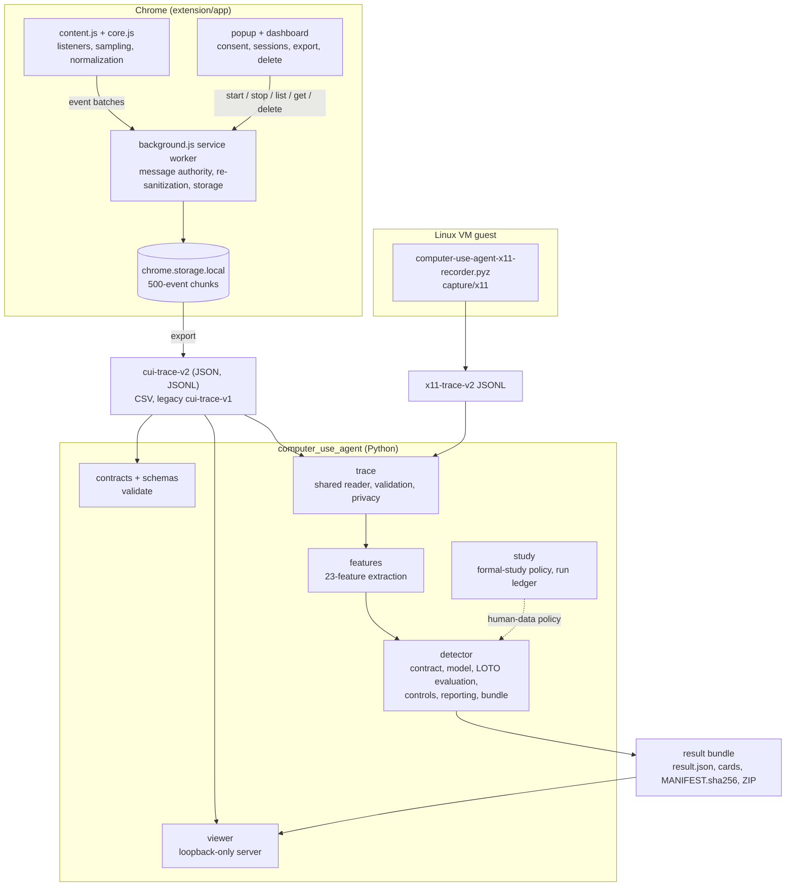

# Architecture

ComputerUseAgent has three shipped parts (the browser recorder, the Python
package with its CLI and viewer, and the X11 guest recorder inside that
package) plus an archived research tree that uses the package but is never
used by it. This page describes the components, the wire formats that connect
them, the package layout and the import rules.

## Components and data flow



| Component | Location | Role |
|---|---|---|
| Content script and core | `extension/app/src/content.js`, `core.js` | Listens for 59 DOM event types in the scoped tab and its same-origin frames, samples pointer, drag, touch and scroll streams, normalizes each event with the privacy rules and sends batches to the service worker. `core.js` is shared with the playground. |
| Service worker | `extension/app/src/background.js` | Classifies every message sender (extension page, content script, anything else), re-sanitizes events, assigns the session ordering fields, enforces the storage limits and writes chunks to `chrome.storage.local`. |
| Popup and dashboard | `extension/app/popup/`, `extension/app/dashboard/` | Consent, session metadata, start and stop; inspection, export and deletion. |
| CLI | `src/computer_use_agent/cli.py` | `validate`, `extract`, `analyze`, `verify-bundle`, `view`, `schema list`/`schema show`, `doctor`. |
| Trace core | `src/computer_use_agent/trace/` | Reads browser and X11 traces, validates them and applies the shared privacy rules. Also shipped inside the X11 guest zipapp. |
| Features | `src/computer_use_agent/features/` | The 23-feature allowlist (`FEATURE_NAMES`, grouped in `FEATURE_GROUPS`), extraction and task-internal descriptive statistics. |
| Detector | `src/computer_use_agent/detector/` | Dataset contract and leakage boundary, deterministic logistic regression with Platt calibration, strict leave-one-task-out evaluation with negative controls and ablations, reporting and the self-verifying result bundle. See [detector.md](detector.md). |
| Viewer | `src/computer_use_agent/viewer/` | Loopback-only, read-only server that serves a privacy projection of traces and results. See [viewer.md](viewer.md). |
| X11 capture | `src/computer_use_agent/capture/x11/` | Guest controller, recorder, calibration and the deterministic zipapp builder (`bundle.py`). Runs on the guest's system Python 3.10. |
| Study policy | `src/computer_use_agent/study/` | Fail-closed formal-study configuration, private-storage rules, run-capsule validation and the immutable run ledger. |
| Research archive | `research/` | Archived harnesses, analyses, literature and evidence. Imports the package; the package never imports it. See [research/README.md](../research/README.md). |
| Repository tooling | `tools/` | CI checks (`tools/ci/`) and the extension packager. |

## Wire formats

Every persisted format carries a `schema_version`. The packaged JSON Schemas
live in `src/computer_use_agent/schemas/` and are listed by
`computer-use-agent schema list`; their `$id` values
(`https://github.com/appleweiping/ComputerUseAgent/schemas/<file>`) are
identifiers, not download URLs.

| Identifier | What it is | Defined by |
|---|---|---|
| `cui-trace-v2` | Browser session export (one JSON envelope, or JSONL) | Packaged schema; written by the extension |
| `cui-trace-v1` | Legacy browser export: read, and produced as an explicit V2-to-V1 projection | Packaged schema |
| `x11-trace-v2` | X11 guest trace (JSONL, `capture_adapter=x11_vm`) | Packaged schema; written by `capture/x11` |
| `cui-detector-extraction-manifest-v1` | Input of `extract`: trace paths with labels, task groups and evidence classes | Validated in `detector/extract.py` |
| `cui-detector-dataset-v2` | Path-free dataset of 23-feature records (`cui-detector-dataset-v1` is read-only) | Packaged schema |
| `cui-detector-analysis-v2` | `result.json` of an analysis bundle | `detector/reporting.py` |
| `cui-source-manifest-v1`, `cui-citation-assertion-v1`, `cui-codex-case-v1` | Research inputs (external datasets, citation edges, Codex cases) | Packaged schemas |
| `cui-formal-study-config-v1`, `cui-run-capsule-v2` | Formal-study configuration and run capsule | `study/policy.py` |
| `cui-recorder-extension-e2e-summary-v1`, `cui-recorder-extension-e2e-run-v1`, `cui-recorder-e2e-event-coverage-v1` | E2E result bundle files | `extension/test/e2e/recorder.e2e.mjs`, checked by `tools/ci/validate_e2e_bundle.py` |
| `cui-recorder-root`, `cui-session-<id>`, `cui-events-<id>-<n>` | `chrome.storage.local` keys | `extension/app/src/background.js` |
| `cui-trace-<task>-<actor>-<id>.{json,jsonl,csv}` | Export file names | `extension/app/dashboard/` |

**The historical `cui-` namespace.** These identifiers come from the
predecessor research project and are kept unchanged on purpose: renaming them
would orphan sessions already stored in users' Chrome profiles, invalidate the
archived evidence under `research/evidence/` and break traces recorded by
earlier versions. Product names, the Python package, the CLI and environment
variables use the new names (`computer-use-agent`, `computer_use_agent`,
`CUA_*`). A breaking change to a wire format gets a new `-vN` identifier, never
a silent edit; wire formats are versioned independently of releases.

## Package layout and dependencies

```text
src/computer_use_agent/
├── __init__.py, __main__.py, cli.py, py.typed
├── schemas/      packaged JSON Schemas (package data)
├── contracts/    schema and contract validation
├── trace/        io.py, validation.py, privacy.py
├── features/     extract.py, statistics.py
├── detector/     contract, extract, model, evaluation, reporting, bundle, pipeline, provenance
├── viewer/       serve.py, privacy.py, static/ (package data)
├── capture/x11/  recorder, guest_controller, calibration, calibration_probe, bundle
└── study/        policy.py, ledger.py
```

- The only runtime dependency is `jsonschema`, used to validate files. The
  detector, features and trace core are standard-library Python and
  deterministic for a given configuration.
- Optional extras: `x11` (python-xlib and PyAutoGUI for the guest), `research`
  and `notebooks` (for `research/` only). None of them is needed by the CLI.
- The wheel contains only `computer_use_agent` with its schemas and viewer
  assets; `research/`, `extension/` and `tests/` are excluded, and the
  extension ships as its own ZIP.

## Import rules

- **The package never imports research or repository tooling.** Nothing under
  `src/computer_use_agent` imports `research`, `tools`, `tests`, `scripts` or
  `experiments`, or names a `research.` module in a string.
  `tests/test_import_boundary.py` enforces this by parsing every product module
  and by importing every product module from the repository root, where
  `research` is importable, and checking that no such module was loaded. The
  X11 capture modules are checked by `tests/capture/test_bundle.py` instead.
- **Research code plugs in through registries.** A research stage that
  produces formal datasets registers a provenance validator with
  `computer_use_agent.detector.provenance.register_provenance_validator`; the
  CLI loads it only when asked (`analyze --provenance-module NAME`). A dataset
  whose provenance has no registered validator fails closed.
- **The guest closure is small and old-Python-safe.** `computer_use_agent/__init__.py`,
  `trace/` and `capture/x11/` must import with the standard library alone and
  run on Python 3.10, because the zipapp runs under the VM guest's system
  Python. `tests/capture/test_bundle.py` builds the zipapp and checks its
  members, its byte-for-byte reproducibility and, when `CUA_GUEST_PYTHON` points
  at a 3.10 interpreter, that it runs there.
- **Private paths come from configuration.** No module derives a location from
  where it is installed or from a drive letter; private data go under
  `CUA_PRIVATE_ROOT`, the formal-study configuration is an explicit argument or
  `CUA_FORMAL_STUDY_CONFIG`.

## Reproducibility and integrity

- The detector result bundle, the extension ZIP and the guest zipapp are
  byte-reproducible; CI builds the extension ZIP twice and compares the bytes.
- One version (`pyproject.toml`, `extension/app/manifest.json`,
  `extension/package.json`, `CITATION.cff`) is enforced by
  `tools/ci/check_versions.py`; the popup reads it from the manifest.
- Archived evidence under `research/evidence/` and the generated literature
  files are bound by `research/evidence/MANIFEST.sha256` and never re-validated
  against current code. Headline numbers are indexed in
  `research/evidence/INDEX.json`, and the README results table is checked
  against it by `tools/ci/check_readme.py`.
