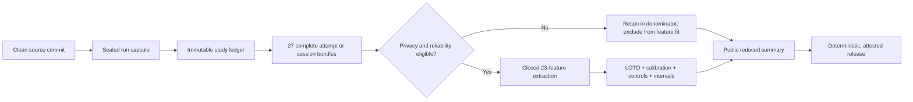

# Related work and the research-engineering contract

This page explains which practices from related projects ComputerUseAgent
reuses, what "research-grade" means for the archived studies under
`research/`, and where each practice stops today. It is an engineering
contract, not a claim that the detector study is complete: no validated
human-versus-agent detector exists, and the formal studies produced no data
(see [summary.md](summary.md)).

## Reference projects and the design choices we reuse

| Reference | Practice worth reusing | Implementation here | Current boundary |
|---|---|---|---|
| [BrowserGym](https://github.com/ServiceNow/BrowserGym) | The task environment owns setup and validation; an agent implementation does not decide whether it succeeded. | The archived MiniWoB harness (`research/week1_miniwob/`) calls the pinned official MiniWoB task `setup()` and `validate()` around each framework adapter. | The formal matrix is 0/27. Historical pilots and scripted controls are kept out of it. |
| [AgentLab](https://github.com/ServiceNow/AgentLab) | A study is a recoverable collection of immutable runs rather than an ad-hoc loop. | `computer_use_agent.study.ledger` binds the planned matrix cells, snapshots of the formal configuration and the run capsule, and the protocol hash; the harnesses' `--resume` option revalidates complete, immutable bundles before skipping them. | No completed formal ledger exists. |
| [OSWorld 2.0](https://github.com/xlang-ai/OSWorld-V2) | Code, task classes, assets, provider image and website release come from one release capsule; a floating `main` is not comparable evidence. | A formal run requires an explicitly passed, sealed run capsule (`cui-run-capsule-v2`, checked by `computer_use_agent.study.policy.validate_capsule`) that hashes code, schemas, framework locks, task manifests and VM pins. | The 2026-08 capsule is archived at `research/archive/release-capsule-2026-08.json` and cannot be sealed; no sealed capsule exists, so formal execution is blocked. |
| [OpenAdapt](https://github.com/OpenAdaptAI/openadapt-capture) | Capture is local-first, privacy-aware, inspectable and recoverable after interruption. | The recorder's `cui-trace-v2` envelope uses bounded local storage, atomic finalization, explicit dropped, rejected and quota counters, recovery status, deletion verification and a privacy-reduced viewer. | Reload, interruption and service-worker restart are covered by the real-Chrome E2E suite; X11 recovery is unit-tested only and was never calibrated inside a VM. |
| [FP-Agent](https://github.com/ethanbwang/fp-agent) | Evaluation must expose cross-family failure instead of reporting only a same-distribution average. | The archived probe runs leave-one-agent-family-out folds and reports the worst family; the detector pipeline adds leave-one-task-out evaluation and negative controls. | FP-Agent remains a same-corpus external probe, not evidence on newly collected matched traces. |

OSWorld 2.0 explicitly warns against mixing code, task, asset, website and
provider-image releases. That is why a changed manifest, dependency lock, VM
snapshot, model endpoint or provider certificate invalidates a batch here
instead of becoming a footnote.

## Evidence hierarchy

The project uses four evidence classes. Moving an artifact upward requires
passing every gate of the higher row; renaming a file is never sufficient.

| Class | What it can establish | Required evidence | What it cannot establish |
|---|---|---|---|
| Unit or property test | A local contract holds for generated and adversarial inputs. | Deterministic test, fixed input, explicit assertion. | Real browser, VM, model or human behavior. |
| Integration or control run | Components work together under a controlled executor. | Real extension and Chrome or guest stack, independent validator, source identity, artifact hashes. | Reasoning-agent or human detection performance. |
| Formal attempt or session | A prespecified matrix cell was launched and retained, including failures. | Sealed capsule, immutable ledger, exact task, actor and framework, complete artifact bundle, private logs, cost and validator evidence. | Generalization beyond the sampled tasks, software, model or participant. |
| Analysis result | A declared estimator was evaluated without leakage. | Eligible matched traces, closed feature allowlist, split audit, calibration, permutation test, negative control, uncertainty interval, deterministic result bundle. | Population or deployment claims without more participants, environments and prospective validation. |

## Hard stop conditions

A formal run must not start or continue when any of these holds:

1. The working tree is dirty, no sealed capsule is supplied, or a capsule input
   hash has drifted.
2. The requested model or its exact resolved snapshot is unavailable, the
   endpoint is not the official one, or a fallback would be needed.
3. A framework dependency graph has an unresolved security gate. Stagehand
   3.7.1 is retired from installation, CI, dispatch and formal execution, and
   no replacement adapter is designated.
4. The projected paid cost exceeds the study's US$200 cap
   (`research/configs/formal-study.json`).
5. A browser target, document epoch, viewport, locale, timezone, extension
   identity, task validator, VM, snapshot, guest or calibration drifts.
6. A recorder bundle is incomplete, lossy without an explicit reliability
   status, privacy-invalid or missing artifact hashes.
7. Human-research use is requested without a private, hash-bound
   human-research determination record (`CUA_HUMAN_RESEARCH_DETERMINATION_RECORD`)
   and explicit consent for the exact session.
8. VM setup would require disabling a host security control such as
   virtualization-based security or Credential Guard.

Failures after launch stay in the formal denominator when their artifact
bundle is complete. They may be excluded from feature analysis when no usable
behavioral modality exists, but they are never silently replaced or rerun under
a different model.

The retired Stagehand 3.7.1 adapter is documented in
[`research/week1_miniwob/adapters/archive/stagehand-3.7.1/`](../../research/week1_miniwob/adapters/archive/stagehand-3.7.1/README.md)
and its pilot in [`research/pilots/stagehand/`](../../research/pilots/stagehand/README.md).
Neither is an active dependency; the frozen protocol keeps its original
three-framework semantics.

## Current state

- Recorder: version 0.5.0, writing `cui-trace-v2` and keeping read and export
  compatibility with `cui-trace-v1`.
- Formal MiniWoB attempts: 0/27. Formal ScienceBoard sessions: 0/27. Codex
  Desktop: all 9 attempts blocked.
- Research-eligible human sessions and matched human/agent pairs: none.
- The detector pipeline has run only on synthetic data and always reports
  `formal_claim_permitted=false`.

Test counts are reported by CI ([ci.md](../ci.md)); they are not a substitute
for the missing formal datasets.

## Release acceptance

A release is acceptable when the required CI jobs are green, the wheel, sdist
and extension ZIP rebuild deterministically, every version string agrees, the
evidence manifest verifies, and the draft GitHub Release carries the SBOM,
`SHA256SUMS` and build-provenance attestations. The procedure is in
[releasing.md](../releasing.md).
